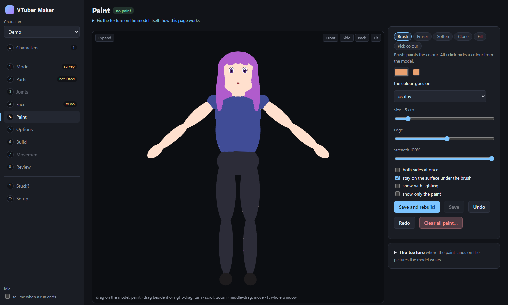
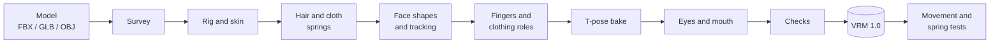

<div align="center">

# OC2VRM

**Turn an image-to-3D character into a ready-to-stream VRM avatar.**

Rigged body, blink and mouth shapes, eye tracking, swinging hair and cloth, toon shading:
from one generated model, in a few minutes, on your own computer.


[Quick start](#-quick-start) · [What you get](#-what-you-get) · [The app](#-the-guided-app) · [How it works](#-how-it-works) · [For AI agents](#-for-ai-coding-agents)



</div>

---

## ✨ What you get

| | |
|---|---|
| 🦴 **A rigged body** | VRM 1.0 humanoid skeleton. Uses Tripo's own rig when the model has one, else places and skins one itself. |
| 😊 **A face that moves** | Blink, the five vowel mouths, ARKit-named shapes for webcam and iPhone face tracking. |
| 👀 **Eyes that look around** | A moving iris for modelled eyes, or sliding eye patches for painted ones. |
| 💇 **Hair and cloth physics** | Spring bones for hair strands, capes, coat tails, skirts, wings and tails, with colliders. |
| 🖐️ **Fingers** | Finger bones found on the hand's surface, laid flat for hand tracking. |
| 🎨 **Toon shading** | MToon materials, and a sharp face texture mapped from the front. |
| 🖌️ **Texture paint** | Fix the texture on the model itself: brush, soften, clone, recolour. Kept apart from the original. |
| ✅ **Checks before you stream** | Stretch and squash per pose, clothing left behind by the arms, drooping springs, contact sheets of the finished file. |

The result loads in **Warudo** and **VNyan**. (VSeeFace reads VRM 0.x only, which isn't exported.)

> [!NOTE]
> An early prototype, tested on a handful of Tripo characters. It gets a simple humanoid most of
> the way; the app tells you what is worth a look, and the last word is always how it looks in
> your tracking app.

## 🚀 Quick start

**You need**

- [Blender](https://www.blender.org/download/) 4.2 or newer (tested: 4.2, 4.5 LTS, 5.2 LTS)
- The [VRM Add-on for Blender](https://extensions.blender.org/add-ons/vrm/) (Blender > Preferences > Get Extensions > "VRM format")
- Python 3.10 or newer, then `pip install -r requirements.txt` (Pillow)
- Optional: `pip install pywebview` for a desktop window instead of a browser tab
- Edge or Chrome, for the contact sheets
- Optional: automatic face marking. The Setup page installs it with one button (Python 3.12 or
  newer, about 250 MB to download, 1.5 GB on disk)

Developed and tested on **Windows**. macOS and Linux should work (the app looks for Blender and
the browser in their usual places there, or takes the paths you give it) but are untested.

**Run it**

```bash
git clone https://github.com/HenriqueDVR/3DVtuber.git
cd 3DVtuber
python -m app.server
```

On Windows, double-click `OC2VRM.bat` instead.

**Make an avatar**

1. **Pick the model** and press *Create the character*. It surveys the model, lists its pieces
   and makes the face patch (a minute or two).
2. **Mark the eyes and mouth** on the picture (*Place them for me* does it with an optional face detector).
3. Press **Save and build** (a few minutes). The Build page says what is in the file and what is
   worth a look.

> [!TIP]
> Best input: in Tripo press **Rig**, pick "VRM 1.0 humanoid", export as **FBX**, with the
> character generated standing in a **T-pose**. Don't use Tripo's rigged GLB: its skeleton is broken.

## 🧰 The guided app

Everything you decide is saved in a character manifest, so a build can be rerun, compared with an
earlier one, or driven by an agent.

| Page | What it is for |
|---|---|
| **Characters** | Every avatar you've started, disk use, a rebuild-and-compare of all of them. |
| **Model** | The survey: how the model stands, what it's made of, which options suit it. |
| **Parts** | Say how each piece moves: hair, hat, cape, hanging sleeve, wing or tail. |
| **Joints** | Drag a joint the detection got wrong. |
| **Face** | The face patch, the twelve face points, eye and mouth choices. |
| **Paint** | Paint on the model: fix smudges, seams and colours the generator got wrong. |
| **Options** | Solid head, cloth physics, chest bounce, fingers, final pose. |
| **Build** | Run the chain, read each step's log, compare two runs pose by pose. |
| **Movement** | Which clothing stays behind when the arms move, what the springs do. |
| **Review** | Contact sheets, renders, a viewer with physics running, notes from your tracking app. |
| **Setup** | What is missing on this computer, and which Blender runs the builds. |

The app runs Blender in the background with only the VRM Add-on on, so whatever else is installed
in your Blender doesn't matter. It needs no internet connection: three.js and three-vrm come with
it (`app/gui/vendor/`, their licences in `THIRD_PARTY.md` there).

## 🔧 How it works

One Blender run per step; each step reads the file the one before it made and writes a new one, so
nothing is overwritten and any step can be rerun on its own.



<details>
<summary><b>From the command line</b></summary>

The same build, without the window. Every command prints JSON.

```bash
python -m app setup                                   # what is missing on this computer
python -m app init samples/my_oc.fbx --name MyOC      # start a character
python -m app prepare out/MyOC/character.json         # survey, piece listing, face patch
python -m app run out/MyOC/character.json             # the whole chain
python -m app status out/MyOC/character.json          # what each step made, what is worth a look
python -m app sheet out/MyOC/character.json           # contact sheets of the finished file
```

All of them, and what to do when something looks wrong: [docs/agent/app.md](docs/agent/app.md).

The older one-shot build, without a manifest:

```bash
python scripts/make_avatar.py samples/my_oc.glb --author "Your name"
```

</details>

<details>
<summary><b>Inside Blender, as an add-on</b></summary>

```bash
mkdir dist
blender --command extension build --source-dir addon/vtuber_maker --output-dir dist
```

Install the zip from `dist/` with Blender > Preferences > Get Extensions > Install from Disk.
Import your model, select it, open the sidebar (N) > **VTuber** tab, and press **Make VRM Avatar**.

For an already rigged avatar with wrong fingers, use **VTuber > Guided Hand Setup**: see
[the hand setup guide](docs/HAND_SETUP.md).

</details>

<details>
<summary><b>Look at a VRM in the browser</b></summary>

```bash
python -m http.server 8321 --bind 127.0.0.1
```

Then open `http://localhost:8321/viewer/index.html?model=/out/my_oc.vrm`: expressions, the check's
poses, skin weights by bone, springs and colliders.

</details>

<details>
<summary><b>Tests</b></summary>

```bash
python -m unittest tests.test_app                                           # the app, seconds
blender -b --factory-startup --python-exit-code 1 -P tests/run_tests.py     # the pipeline, minutes
```

</details>

## 🤖 For AI coding agents

The project is built to be driven by an agent as well as by hand.

| Start here | For |
|---|---|
| [AGENTS.md](AGENTS.md) | Working on the code: environment, code map, rules. |
| [AVATAR_GUIDE.md](AVATAR_GUIDE.md) | Walking a person from their character art to a streaming avatar. |
| [docs/agent/app.md](docs/agent/app.md) | Driving a build with `python -m app`. |
| [docs/agent/troubleshooting.md](docs/agent/troubleshooting.md) | Symptom, measured cause, fix. |

Stuck on something no option fixes? The app's **Stuck?** page gathers the manifest, checks, logs
and renders into one folder for an agent to pick up.

## 📌 Scope and limits

- **Works on**: one humanoid character standing in a T-pose (best) or an A-pose. Hats, capes,
  coats, skirts, wings and tails are handled through piece roles.
- **Not for**: creatures, quadrupeds, or several characters in one file.
- **Runs locally**: nothing is uploaded. Models and builds stay in `samples/` and `out/` on your
  computer.
- **Licence**: [MIT](LICENSE). The bundled three.js, three-vrm and MediaPipe keep their own
  licences (`app/gui/vendor/THIRD_PARTY.md`).
- **Limits**: fingers track less well than a hand-made avatar's; lips barely move (the mouth opens
  a drawn interior); cloth between arm and body can stretch with the arms raised high. The full
  list is at the end of [AVATAR_GUIDE.md](AVATAR_GUIDE.md).
